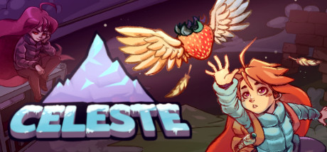

**Celeste is the critically acclaimed precision platformer about Madeline climbing Celeste Mountain while battling anxiety and self-doubt. Features demanding but fair movement mechanics, Chapter 9's C-Side equivalent, and an emotionally resonant narrative about mental health.**

---

## 📖 About

Celeste is the critically acclaimed precision platformer about Madeline climbing Celeste Mountain while battling anxiety and self-doubt. Features demanding but fair movement mechanics, Chapter 9's C-Side equivalent, and an emotionally resonant narrative about mental health.

## ⚠️ Problems Without Trainer

| Problem | Status |
|---------|--------|
| **C-Side Brutality** — C-Side chapters are among the hardest platforming sequences ever designed | ✅ Solved |
| **Strawberry Count** — Collecting all 202 strawberries requires mastering every movement tech | ✅ Solved |
| **Crystal Heart Puzzles** — Finding all Crystal Hearts requires solving cryptic environmental puzzles | ✅ Solved |
| **Chapter 9** — Farewell is a 40-minute gauntlet of extreme difficulty designed for experts only | ✅ Solved |

## ✅ Solution

The **Celeste Trainer** solves all these issues by giving you complete control over the game.

## 🎯 Full Feature List

- Unlimited Resources
- God Mode / Invincibility
- Instant Skill Cooldown
- One-Hit Kill
- Freeze Game Timer
- Unlock All Items & Achievements
- Custom Speed Multiplier
- Save State Anywhere

## 🚀 Quick Start

1. **Disable Windows Defender** temporarily (trainer may trigger false positive)
2. Download the trainer from the button above
3. Launch Celeste
4. Run the trainer as Administrator
5. Activate desired cheats with hotkeys

## 💎 Free vs Paid

| Feature | Free | Pro |
|---------|------|-----|
| Basic God Mode | ✅ | ✅ |
| Unlimited Resources | ✅ | ✅ |
| All Advanced Cheats | ❌ | ✅ |
| Auto-Updates | ❌ | ✅ |
| Priority Support | ❌ | ✅ |

## 💻 Requirements

- Windows 10/11 (64-bit)
- Celeste (any version)
- .NET Framework 4.8+
- DirectX 11+

## 🍎 macOS

macOS users can use our alternative tool:

## ⚖️ Legal

This trainer is for educational and single-player use only. Use responsibly.

---

